# Video Analysis Workbench · Video X-Ray

> A video + audio analysis workbench plugin for **Hermes Desktop**.
> One run = **windowed frame sampling** → **per-segment visual observation** → **timestamped transcript** → **structured report** → **shot-accurate reverse prompt for AI video generation**.

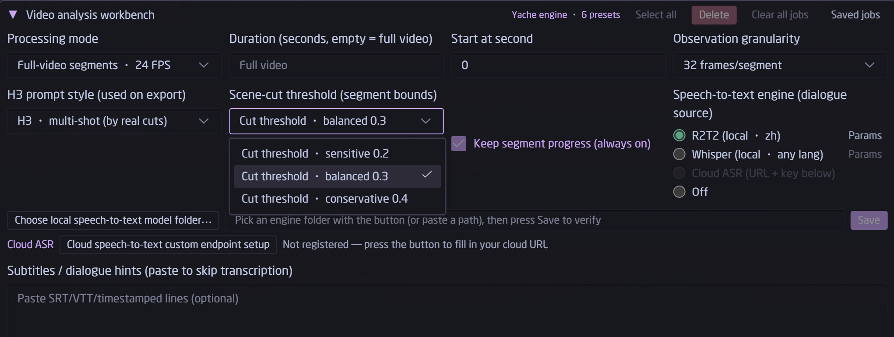

- UI language: **English / Simplified Chinese**, follows your Hermes display language automatically; other locales fall back to English (translation PRs welcome)
- Author: Xiaoya / [LuuMoss](https://github.com/LuuMoss) · License: Apache-2.0 (see [LICENSE](LICENSE) and [NOTICE.md](NOTICE.md))
- Also exposes `video_xray` / `video_xray_jobs` agent tools — just ask your assistant "analyze this video" in chat

---

## What it does

| Capability | Details |
|---|---|
| 🎞️ **Windowed visual observation** | Pick any time window (or the whole video); frames are sampled and grouped into observation segments at your chosen granularity (8/16/32/64 frames per segment) and fed to your vision LLM. Cost scales linearly. Via the agent tools there is also an `adaptive` sampling mode that densifies frames around detected scene changes |
| 🎙️ **Transcription, three engines** | Local **R2T2** (best for Chinese) · local **Whisper** (multilingual) · **cloud OpenAI-compatible ASR** · off. If installed engines are missing, the ladder degrades gracefully instead of failing the job |
| 📝 **Timestamped dialogue** | Standard SRT + JSON cue export — import straight into CapCut, Premiere, or any player |
| 📊 **Structured report** | Plot flow, camera language, characters & settings, timestamped quote references, opening-vs-ending contrast — saved as Markdown |
| 🔄 **Prompt reverse-engineering** | Turns the analysis into a **MiniMax-H3** video-generation prompt, segmented at **real shot cuts** (threshold adjustable 0.05–0.95) in multi-shot mode, or continued as one take. The body text is plain natural-language shot description — strip two formatting lines and it works for Kling, Jimeng, Vidu, Runway, etc. |
| ⏹️ **Cancel / resume** | Cancel is graceful: the transcription worker exits within a second and VRAM is returned instantly (no screen freeze). Resume continues from the interrupted segment — completed segments are never recomputed |
| 🧠 **Zero LLM config** | Analysis follows the model your Hermes Desktop is currently chatting with (local or cloud) — no endpoints, no keys |

## Requirements

- **Hermes Desktop ≥ 0.22** (the desktop plugin-panel era)
- **ffmpeg** on PATH — if you don't have it: `winget install Gyan.FFmpeg`
- Any working chat model, local GPU engine or cloud API alike

## Installation (3 steps, ~2 minutes)

> Windows paths. `%LOCALAPPDATA%` is usually `C:\Users\<you>\AppData\Local`.

**① Backend** — copy the plugin files from the **root of this repo** (`plugin.yaml`, `__init__.py`, `engine/`, `dashboard/`) to:

```
%LOCALAPPDATA%\hermes\plugins\video-xray\
```

**② Enable + restart the gateway:**

```bat
"%LOCALAPPDATA%\hermes\bin\hermes.exe" plugins enable video-xray
```

Then fully quit Hermes Desktop and reopen it (this restarts the gateway and loads the backend).

**③ Frontend hot-load** — copy the repo's `desktop/plugin.js` to:

```
%LOCALAPPDATA%\hermes\desktop-plugins\video-xray\plugin.js
```

and press `Ctrl+Shift+R` in the desktop app to reload the UI.

You should now see the golden **Video Analysis Workbench** strip above the composer. `/video` opens it too, and chatting "analyze this video" works via the agent tools.

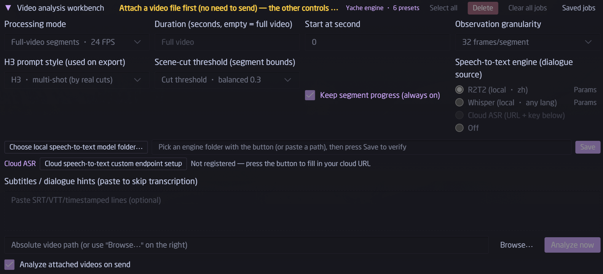

## Transcription engines (all optional — the plugin runs without any of them)

In the workbench panel, pick an engine with the radio group: `R2T2 (local · zh)` / `Whisper (local · any lang)` / `Cloud ASR` / `off`. Engines you haven't installed are greyed out with a tooltip pointing you to the right section below. When the plugin is driven from chat (agent tool), an additional `auto` ladder picks whichever engine you have installed and degrades gracefully.

### Whisper — recommended starting point (multilingual, ~5 min)

```powershell
python -m venv $env:LOCALAPPDATA\hermes\whisper-venv
$env:LOCALAPPDATA\hermes\whisper-venv\Scripts\pip install faster-whisper
```

Then in the panel: `Transcription settings → Whisper → Register local engine`, pick this venv's `whisper-venv\Scripts\python.exe` and hit **Save**. Saving performs a real engine load on your machine — it only turns green if the engine actually starts (the model itself downloads on first use).

### Cloud ASR — zero local dependency

Any **OpenAI-compatible** `/v1/audio/transcriptions` service: fill base URL + model + key under `Transcription settings → Cloud ASR` and hit **Test connection** (it performs a real silent transcription round-trip before accepting).

### R2T2 — best local Chinese transcription (optional, ~3.5 GB download)

R2T2 is NetEase Youdao's open-source [Confucius4-R2T2](https://github.com/netease-youdao/Confucius4-R2T2) speech engine (code Apache-2.0; weights free for commercial use). This repo ships the **adapter source** (`docs/r2t2-runtime/`); you fetch the runtime binaries and weights yourself:

Target layout:

```
%LOCALAPPDATA%\hermes\asr-r2t2\
├── worker.py, smoke.py          ← copy from this repo's docs/r2t2-runtime/
├── core\confucius\*.py          ← same (upstream engine source + patches)
├── runtime\
│   ├── python\                  ← embedded Python 3.12 (step ②)
│   └── native-cpu\              ← official native inference libs (step ②)
└── models\                      ← the four weight files (step ③)
```

**① Adapter layer**: copy `worker.py`, `smoke.py` and `core/` from this repo's `docs/r2t2-runtime/` into `%LOCALAPPDATA%\hermes\asr-r2t2\`.

**② Runtime** (embedded Python + native libs, ~300 MB): download any 0.2.x `…-NoMainModel.zip` portable pack from [T8mars/Strata-T8 releases](https://github.com/T8mars/Strata-T8/releases) and copy two trees:

```powershell
robocopy <extracted>\runtime\python          $env:LOCALAPPDATA\hermes\asr-r2t2\runtime\python     /E
robocopy <extracted>\runtime\asr\native-cpu  $env:LOCALAPPDATA\hermes\asr-r2t2\runtime\native-cpu /E
```

**③ Weights** (Q8 model + audio projector + VAD, with their licenses, ~3.2 GB):

```powershell
pip install -U huggingface_hub
hf download t8star/Confucius-R2t2-Comfy --repo-type model --local-dir $env:LOCALAPPDATA\hermes\asr-r2t2\models
# China-friendly mirror: append  --endpoint-url https://hf-mirror.com
```

(The upstream model repo is [netease-youdao/Confucius4-R2T2-GGUF](https://huggingface.co/netease-youdao/Confucius4-R2T2-GGUF); the mirror above also bundles the VAD helpers, all license files, and a per-file SHA-256 table.)

**④ Register**: panel `Transcription settings → R2T2 → Register local engine`, pick the `asr-r2t2` **root directory** (the one containing `worker.py` — picking anything else is rejected), and wait for the on-machine load check to turn green.

> NVIDIA GPU owners: drop the `.pyd` from the cu128 wheel ([T8mars R2T2 node releases](https://github.com/T8mars/comfyui-confucius-r2t2-t8/releases), `native-v0.2.0`) plus the CUDA trio into `runtime\native-cuda\python\`, then switch the device in `Params` (saving also runs a real load check). In practice the CPU engine matches CUDA speed on this small model — **CPU is the recommended default**, it keeps your VRAM free.

## Using the results

After a job completes, the detail view exports the report (`.md`) and the reversed prompt (`.txt`), with copy buttons for both.

- **SRT / JSON cues**: plain universal formats, import anywhere
- **Report**: ordinary Markdown for humans — and great raw material for a follow-up AI rewrite
- **Reversed prompt**: ready for MiniMax-H3; for other generators (Kling, Jimeng, Vidu, Runway…) delete the `integrated_multimodal_description:` line, the `[Shot N]` markers and the trailing H3 magic line — the remaining shot descriptions are generator-agnostic

## FAQ

| Symptom | Fix |
|---|---|
| No golden strip above the composer | Make sure step ② (enable + gateway restart) was done; press `Ctrl+Shift+R`; check `%LOCALAPPDATA%\hermes\logs\desktop.log` for `[plugins]` lines |
| "Analyze now" says engine not ready | Analysis uses your **current chat model** — send one normal chat message first to confirm the model is up |
| Report shows `transcript=no` | There simply was no speech in that window (SFX/music only) — normal |
| R2T2 registration refuses to save | Pick the **root** folder containing `worker.py`; make sure `runtime\python\python.exe` and the `models\` four-piece set are in place (layout above) |
| Cancelled a job, want the rest | Hit **Resume** (amber) in the job list — completed segments are not recomputed |
| VRAM pressure | Use the R2T2 CPU engine (benchmarked on par with CUDA); transcription workers exit right after use and never linger |

## Credits & license chain

- **R2T2** engine: [netease-youdao/Confucius4-R2T2](https://github.com/netease-youdao/Confucius4-R2T2) — code Apache-2.0; weights under the [NetEase Youdao Model Use License](https://huggingface.co/netease-youdao/Confucius4-R2T2-GGUF/blob/main/MODEL_LICENSE) (free commercial use; trademark & very-high-scale usage terms apply)
- Windows runtime binaries redistributed by [T8mars](https://github.com/T8mars) ([Strata-T8](https://github.com/T8mars/Strata-T8) MIT; [R2T2 node](https://github.com/T8mars/comfyui-confucius-r2t2-t8) follows upstream Apache-2.0) — thanks for enabling derivative-friendly use; this plugin and their packs cross-promote each other
- Underlying inference: [ggml ggml / llama.cpp](https://github.com/ggml-org/llama.cpp) (MIT, see runtime `NOTICE`), [FireRedVAD](https://github.com/FireRedTeam/FireRedVAD) (Apache-2.0)
- Alternate transcription: [faster-whisper](https://github.com/SYSTRAN/faster-whisper) (MIT)
- This plugin's own code (including the `docs/r2t2-runtime/` adapter and patches): Apache-2.0 — see [LICENSE](LICENSE) / [NOTICE.md](NOTICE.md)

## Gallery

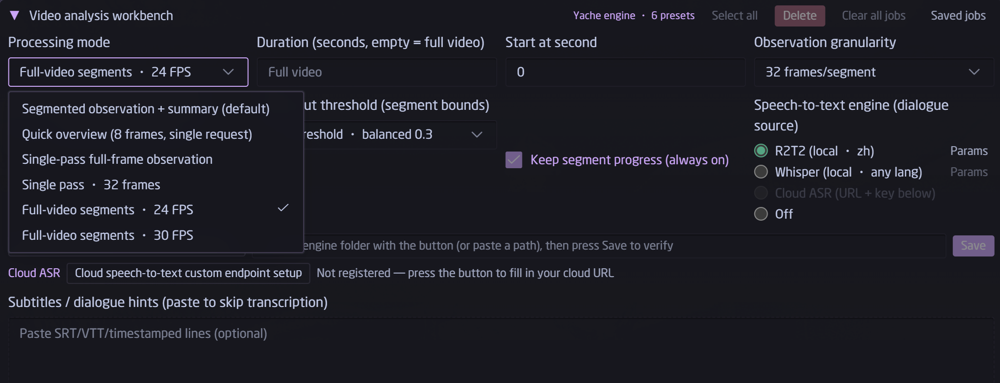
*Processing mode: six built-in presets, or `custom` to write your own observation prompt.*


*After attaching a video: time window, granularity, shot-cut threshold, transcription engine radio group and the register/params buttons.*

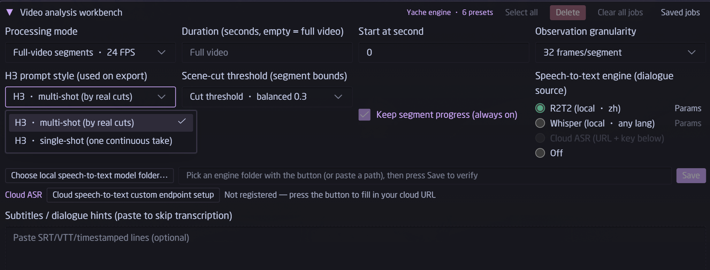
*H3 prompt style: per-shot segmentation vs single-take continuation.*

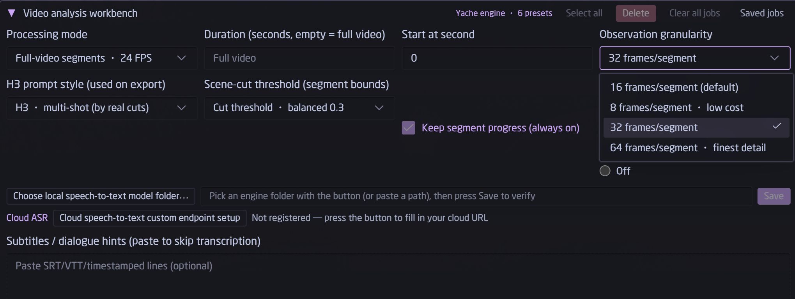
*Frames per segment: 8 / 16 / 32 / 64 — cost scales linearly.*

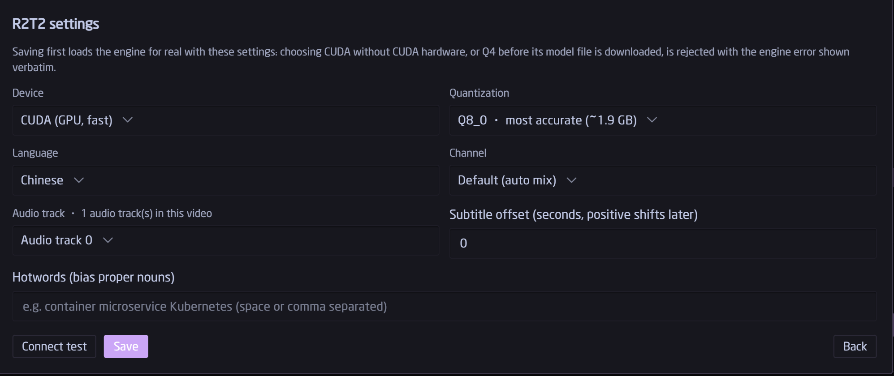
*Engine parameters. `Save` loads the engine for real as a check — a wrong combo is rejected with the engine's own error, never stored silently.*

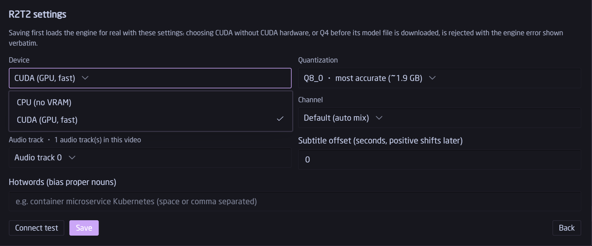
*Device: `CPU (no VRAM)` or `CUDA (GPU, fast)`.*

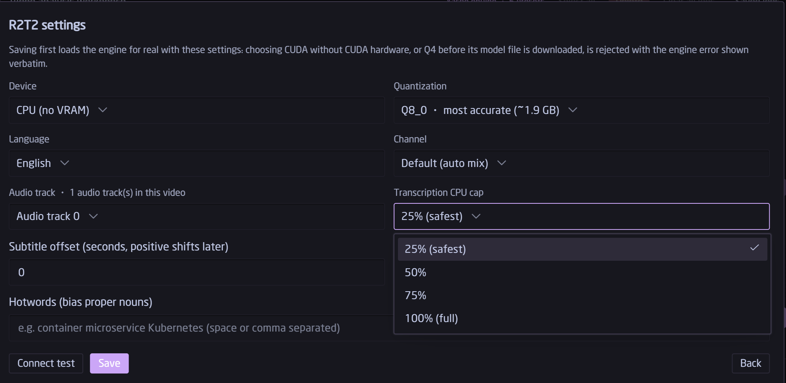
*Hard CPU-usage cap so transcription never freezes your machine.*

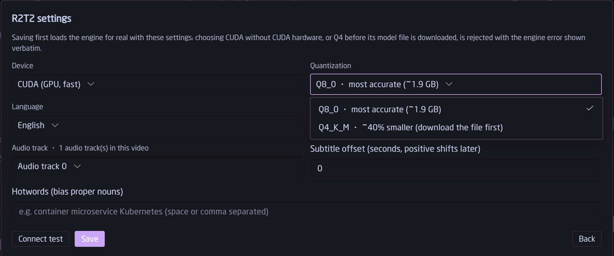
*Quantization: `Q8_0` (most accurate) or `Q4_K_M` (~40% smaller; download the weights file first).*

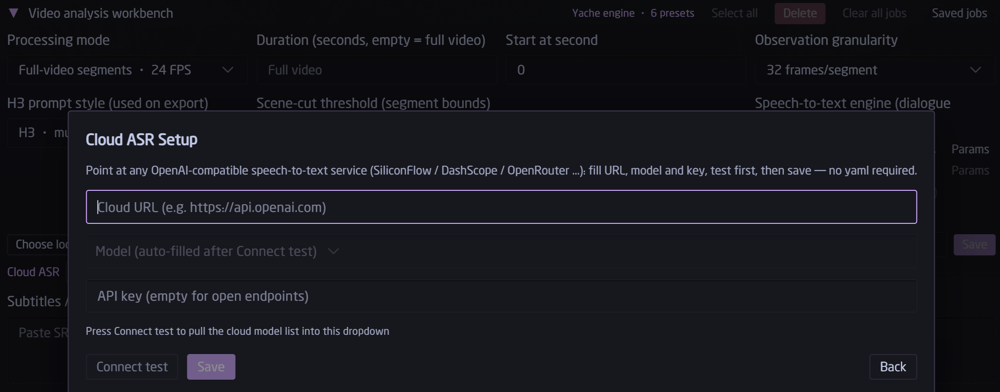
*OpenAI-compatible endpoint + model + masked key, with real test buttons.*

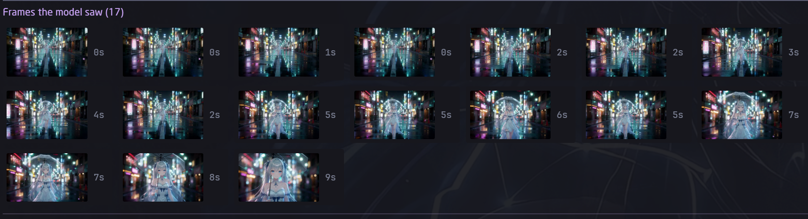
*Frame gallery (new in 0.2.0): every frame the engine sampled, timestamped, click for full view — an instant gut-check on sampling coverage.*

Full-size frames pulled straight from the demo clip behind that strip (AI-generated with ComfyUI, so nothing here is private footage):


## Localization

Wordbook lives in `desktop/plugin.js` (`MESSAGES`, two locales today: `zh` and `en`). The host automatically falls back to English for every other locale, so a single-file translation PR instantly makes the whole UI speak your language. Welcome aboard!

## License

Apache-2.0 © 2026 LuuMoss (Xiaoya). Third-party runtime components keep their own licenses — see [NOTICE.md](NOTICE.md).
